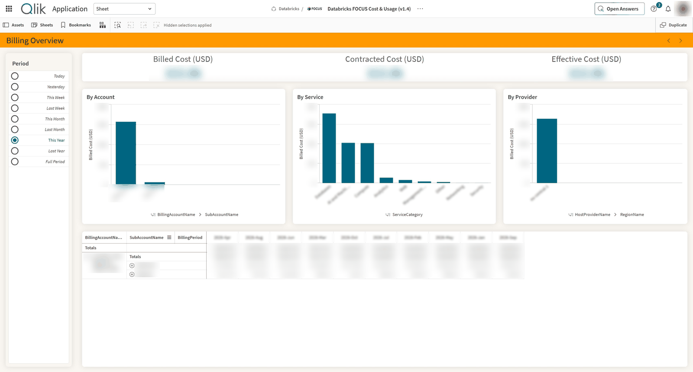
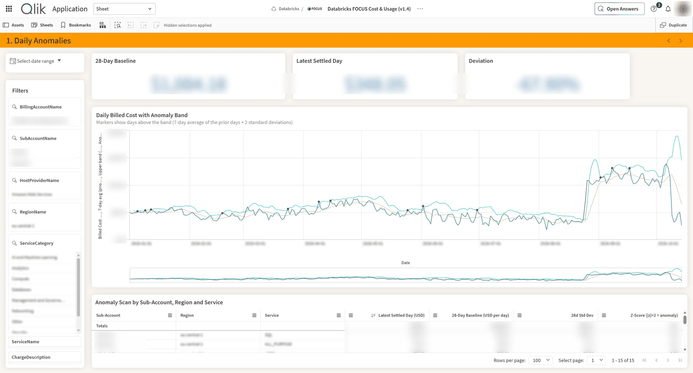
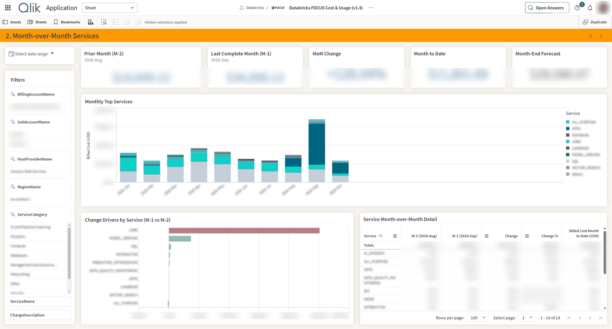
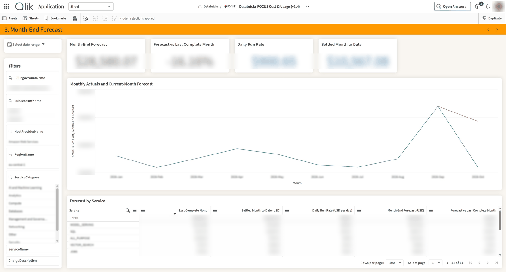
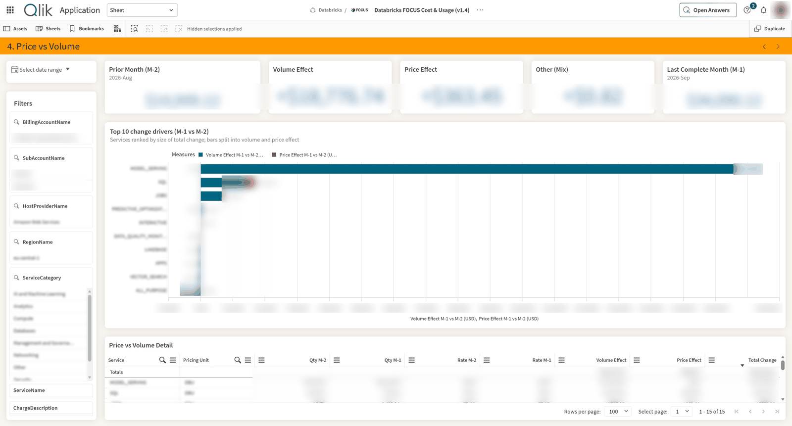
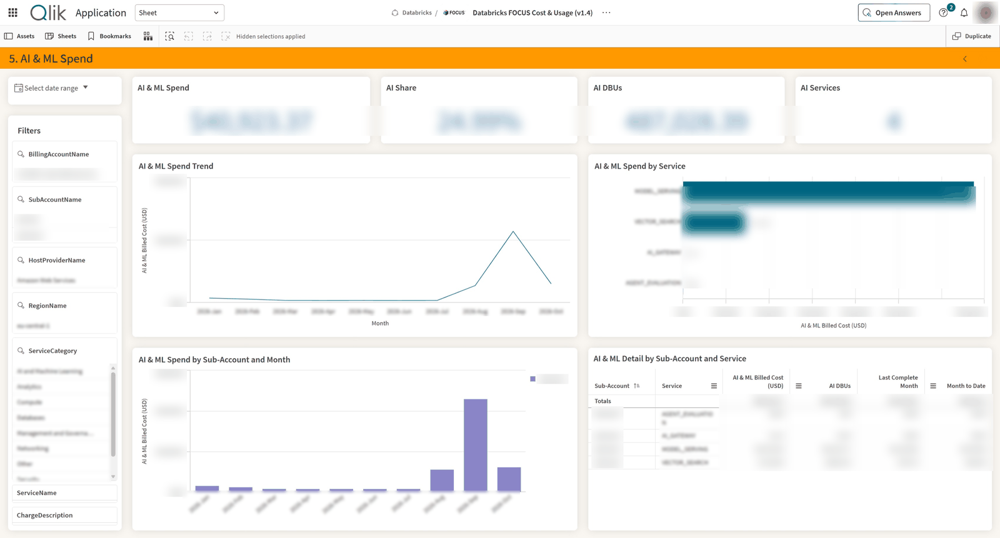

# FinOps: AWS FOCUS Cost & Usage for Qlik Cloud

A Qlik Cloud Analytics app that monitors AWS consumption and spend across the accounts in an AWS organization, using billing data in the [FOCUS™](https://focus.finops.org/) (FinOps Open Cost & Usage Specification) v1.2 format. Paired with Qlik's Discovery Agent, it detects cost anomalies after each reload.

## What is here

| File | What it is |
|---|---|
| `aws-focus-cost-usage.qvf` | The "AWS FOCUS Cost & Usage (v1.2)" app, exported **without data**: load script, sheets, charts, master items, variables and thumbnails. |

## How the data is built

AWS publishes billing data in FOCUS format through [AWS Data Exports](https://docs.aws.amazon.com/cur/latest/userguide/dataexports-create.html). An export of the table **FOCUS 1.2 with AWS columns** (`FOCUS_1_2_AWS`) writes Parquet files to an S3 bucket, at least once a day:

```
s3://<your-bucket>/<prefix>/<export-name>/data/billing_period=YYYY-MM/<export-name>-00001.snappy.parquet
s3://<your-bucket>/<prefix>/<export-name>/metadata/billing_period=YYYY-MM/<export-name>-Manifest.json
```

Files for the open billing period are overwritten on each refresh, so days in an open month can still change until the month closes.

The load script reads those files through a Qlik **Amazon S3 V2** connection:

1. **Explicit file paths.** The Amazon S3 V2 connector returns nothing for `DirList`, `FileList` or wildcard paths, so the script builds each path from the naming pattern above. It walks back `vMonthsBack` billing periods (default 36) and file numbers `00001`, `00002`, …, using `FileSize()` to test whether each file exists.
2. **FOCUS columns.** It loads the FOCUS standard columns used by the app plus the AWS `x_ServiceCode` and `x_Operation` columns. `ProviderName` is renamed to `HostProviderName`. Map/JSON columns (`Tags`, `SkuPriceDetails`) are not loaded.
3. **Calendar fields.** It derives `ChargeDate`, `ChargeYearMonth`, `BillingPeriod` and the relative-period fields `DayRelNo`, `WeeksAgo`, `MonthsAgo` and `YearsAgo`, anchored to the reload date.

## What the app covers

- **Allocation**: spend by account (sub-account), region, service category, service, charge category and provider.
- **Reporting and analytics**: daily and monthly trends, sliceable across every FOCUS dimension.
- **Anomaly management**: statistical outliers by day and service, plus Discovery Agent insights.
- **Forecasting**: month-end projection from the settled month to date and the 7-day run rate.
- **Rate tracking**: price vs volume split per service and pricing unit.

### Sheets

| Sheet | What it answers | Time window |
|---|---|---|
| About | Purpose, data source, freshness, cost definitions, access requirements | — |
| Billing Overview | Billed, Contracted and Effective Cost by account, service and provider | The Period selector (today, last week, this year, …) |
| 1. Daily Anomalies | Which days and accounts, regions and services spent unusually | Latest settled day (1 day before reload) vs the 28 days before it |
| 2. Month-over-Month Services | How service costs changed month over month | M-1 vs M-2, plus month to date and forecast |
| 3. Month-End Forecast | Where the current month will land | Settled month to date + 7-day run rate × remaining days |
| 4. Price vs Volume | Whether a change came from usage (volume), rates (price) or new/dropped services (mix) | M-1 vs M-2 |
| 5. AI & ML Spend | What Amazon Bedrock, SageMaker and other AI and Machine Learning services cost | Current selections |

M-1 and M-2 are the 2nd and 3rd most recent months in the current selection (variables `vSAM-1`/`vSAM-2`). With nothing selected, they are the last complete month and the month before. Rates are always calculated per pricing unit, so different units are never mixed.

<details>
<summary>Sheet screenshots</summary>

**Billing Overview**



**1. Daily Anomalies**



**2. Month-over-Month Services**



**3. Month-End Forecast**



**4. Price vs Volume**



**5. AI & ML Spend**



Values and dimension labels are blurred.

</details>

### Cost measures

| Measure | Meaning (FOCUS definitions) |
|---|---|
| List Cost | List unit price × pricing quantity (public on-demand price) |
| Contracted Cost | Contracted unit price × pricing quantity (after negotiated discounts) |
| Billed Cost | Amount invoiced for the charge, net of credits |
| Effective Cost | Amortized cost after Savings Plans and Reserved Instances |
| Usage Cost | Billed Cost of `ChargeCategory = Usage` only: gross consumption before credits |
| Credits | Billed Cost of `ChargeCategory = Credit` (promotional and free-tier credits, negative) |

Billed Cost is the invoice amount, so it is net of credits. When credits cover all usage, Billed Cost is $0 while the AWS billing console still shows consumption: compare that figure with **Usage Cost**. All master measures are rounded to the cent. All costs are in the billing currency (USD).

## Prerequisites

- A Qlik Cloud Analytics tenant (Discovery Agent is optional).
- An AWS account with access to Billing and Cost Management. For an organization, create the export in the management account to cover every member account.
- An S3 bucket for the export, in the same account as the export.
- A dedicated IAM user (or role) for Qlik with read-only access to the export prefix:

  ```json
  {
    "Version": "2012-10-17",
    "Statement": [
      {
        "Effect": "Allow",
        "Action": "s3:GetBucketLocation",
        "Resource": "arn:aws:s3:::<your-bucket>"
      },
      {
        "Effect": "Allow",
        "Action": "s3:ListBucket",
        "Resource": "arn:aws:s3:::<your-bucket>",
        "Condition": { "StringLike": { "s3:prefix": ["", "<prefix>", "<prefix>/*"] } }
      },
      {
        "Effect": "Allow",
        "Action": "s3:GetObject",
        "Resource": "arn:aws:s3:::<your-bucket>/<prefix>/*"
      }
    ]
  }
  ```

## Installing

### 1. Create the AWS Data Export

1. In the AWS console, go to **Billing and Cost Management → Data Exports → Create**.
2. Choose **Standard data export** and the table **FOCUS 1.2 with AWS columns**. Keep all columns.
3. Set the S3 destination: your bucket and a prefix (for example `focus1.2`). Let AWS apply the bucket policy it needs to write.
4. Keep **Parquet** and **Overwrite existing export files**.
5. Name the export (for example `FOCUS-1-2-Export`). The name becomes the folder and file prefix the load script reads.

The first files can take up to 24 hours to arrive. AWS can also backfill earlier months through a support case.

### 2. Upload the app

1. In Qlik Cloud, go to **Create → Upload app** and choose `aws-focus-cost-usage.qvf`. It contains the load script, sheets, master items, variables and thumbnails, but no data.
2. Pick a shared space (for example `Amazon Web Services`) where you can create data connections. The connection must be in the same space, or in a space the app can read.

Don't reload yet: the connection the script refers to doesn't exist in your tenant.

### 3. Create the Amazon S3 connection

1. Open the app's **Data load editor** and click **Create new connection → Amazon S3 V2**.
2. Fill in:

   | Setting | Value |
   |---|---|
   | Region | The bucket's region |
   | Bucket name | `<your-bucket>` |
   | Root prefix | The export prefix, for example `focus1.2` |
   | Credentials | Access key ID and secret access key of the IAM user above |

3. Name it, click **Test connection**, then **Create**.

### 4. Update the load script

The script is already in the app; only the connection and export name may need changing.

1. In **Data load editor**, open the **Main** tab and find:

   ```qlik
   SET vConn = 'lib://Amazon Web Services:Amazon_S3_V2_CUV';
   SET vExportData = '$(vConn)/FOCUS-1-2-Export/data';
   ```

2. Change `vConn` to `lib://<SpaceName>:<ConnectionName>` for your connection.
3. If your export has another name, change `FOCUS-1-2-Export` in `vExportData`, and the `FOCUS-1-2-Export-` file prefix on the **FOCUS Cost & Usage** tab.
4. Optional: change `vMonthsBack` on the **FOCUS Cost & Usage** tab to look for more or less history.
5. Don't change the field names in the LOAD: the sheets and master measures depend on them.
6. Click **Load data**. The log ends with `Loaded N Parquet file(s).`

If the reload fails:

| Message | Cause |
|---|---|
| `WARNING: no Parquet files found` | The export hasn't delivered yet, or `vExportData` / the file prefix don't match the S3 path. Paths are case-sensitive: AWS writes `billing_period=` in lowercase |
| `Cannot open file … (Connector error: File not found)` | A path in the script doesn't exist; check the export name and the connection's root prefix |
| `Access Denied` | The IAM user lacks `s3:GetObject` on the export prefix |

### 5. Validate and schedule

1. Compare **Usage Cost** for a closed month with the Usage line in AWS Cost Explorer (Unblended Cost grouped by record type), and **Billed Cost** with the invoice.
2. Schedule a daily reload. The relative periods (Today, This Month, …) are anchored to the reload date.

### Optional: Discovery Agent

In the Qlik Cloud Administration console, enable cross-region data processing and assign the Discovery Agent role to the users who should receive insights. Then enable Discovery Agent on the app and create a trigger group on Billed Cost (USD) with time dimension `BillingPeriod`, broken down by `SubAccountName`, `ServiceName` and `ChargeDescription`.

## Resources

- [AWS Data Exports](https://docs.aws.amazon.com/cur/latest/userguide/dataexports-create.html)
- [FOCUS 1.2 with AWS columns table dictionary](https://docs.aws.amazon.com/cur/latest/userguide/table-dictionary-focus-1-2-aws.html)
- [Qlik Amazon S3 V2 connector](https://help.qlik.com/en-US/cloud-services/Subsystems/ODBC_Connector_help/Content/Connectors_QWC/Data-Source-Connectors/Amazon-S3-V2-connector.htm)
- [Qlik Discovery Agent documentation](https://help.qlik.com/en-US/cloud-services/Subsystems/Hub/Content/Sense_Hub/DiscoveryAgent/discovery-agent.htm)
- [FOCUS specification](https://focus.finops.org)

## License

Everything in this repository is under the Apache 2.0 [LICENSE](../LICENSE).

FOCUS™ is a trademark of the FinOps Foundation.
